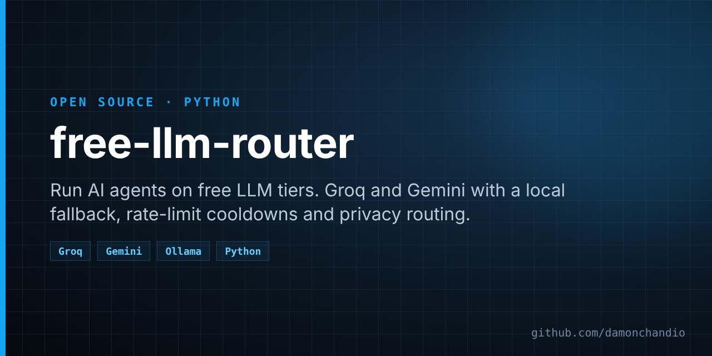

# free-llm-router



[](https://github.com/damonchandio/free-llm-router/actions/workflows/tests.yml)   [](https://github.com/damonchandio/free-llm-router/stargazers)

Run your agents on free LLM tiers without them falling over at the first rate limit, and without sending private data to free tiers that may train on it.

Free tiers are generous but fragile. Groq gives you fast open models but a small per-minute token budget. Gemini's free tier writes well but allows only a handful of calls a day for its best model, and Google may use free-tier prompts to improve its products. A local model is always there but slower. `free-llm-router` puts the three behind one `ask()` call: it picks the right backend for each request, rests a backend that says "slow down" for exactly as long as it asked, and falls through to the next one instead of failing.

One file, one dependency (`requests`).

## Quick start

```bash
pip install git+https://github.com/damonchandio/free-llm-router
export GROQ_API_KEY=...      # free at console.groq.com
export GEMINI_API_KEY=...    # free at aistudio.google.com (optional)
```

```python
from free_llm_router import Router

ai = Router()
print(ai.status())

ai.ask("You are concise.", "Explain retrieval-augmented generation in one line.")

# Private data never goes to Gemini's free tier
ai.ask("Summarise in three bullets.", my_emails, private=True)

# Best writer first, for the few jobs a day that need it
ai.ask("You write LinkedIn posts.", "A post about our launch.", quality=True)

# Live web search (Groq's built-in browser_search), or an error: never invented results
ai.ask("Answer with sources.", "Latest Python release?", web=True)

# Parsed JSON
ai.ask_json("Extract fields.", "Name: Ada, role: engineer")   # {"name": "Ada", "role": "engineer"}
```

## Which backend answers

| Request | Order tried |
|---|---|
| default | Groq → Gemini Flash-Lite → local (Ollama) |
| `quality=True` | Gemini Flash → Groq → Gemini Flash-Lite → local |
| `private=True` | Groq → local (never Gemini) |
| `web=True` | Groq with `browser_search` only |
| `images=[...]` | Groq vision model if set → Gemini Flash-Lite (private pictures only with `VISION_GEMINI=1`) |

A backend that refuses is rested before it's tried again:

| Response | Rest |
|---|---|
| 429 with `retry-after` | as long as it asked |
| 429 per-day limit | 1 hour |
| 429 otherwise | 60 seconds |
| 401 or 403 (bad key) | 24 hours |

Rests are per model and per `Router` instance, so a busy model is skipped instantly instead of waited on.

## Privacy routing

Groq states that it doesn't train on API data. Google's free Gemini tier may use prompts to improve its products. So anything marked `private=True` (emails, messages, screenshots, personal documents) is only ever sent to Groq or your own machine. If neither can answer, you get an `AIError`, not a quiet leak.

## Configuration

Everything is a constructor argument or an environment variable:

| Setting | Env var | Default |
|---|---|---|
| Groq key | `GROQ_API_KEY` | none |
| Gemini key | `GEMINI_API_KEY` | none |
| Groq model | `GROQ_MODEL` | `openai/gpt-oss-120b` |
| Groq web model | `GROQ_WEB_MODEL` | `openai/gpt-oss-120b` |
| Groq vision model | `GROQ_VISION_MODEL` | none |
| Gemini model | `GEMINI_MODEL` | `gemini-3.8-flash` |
| Gemini light model | `GEMINI_LITE_MODEL` | `gemini-3.5-flash-lite` |
| Ollama URL | `OLLAMA_URL` | `http://127.0.0.1:11434` |
| Ollama model | `OLLAMA_MODEL` | `qwen2.5:7b` |
| Private pictures to Gemini | `VISION_GEMINI=1` | off |

`ask(..., local=False)` leaves out Ollama, for callers that run their own local fallback.

## Honest caveats

- Free-tier limits and model names change often. If a default model disappears, set the env var to its replacement.
- This is a fallback chain, not a load balancer: it doesn't spread traffic, it just keeps answering.
- Rests live in memory, so a restart forgets them.
- Check each provider's current terms yourself before relying on the privacy routing.

## Tests

```bash
python -m unittest discover -s tests -t .
```

The tests are offline: every HTTP call is mocked.

## Credits

Built by Damon Chandio ([Damon Dynamics](https://damondynamics.co.uk)), extracted from his personal agent. MIT licence.
